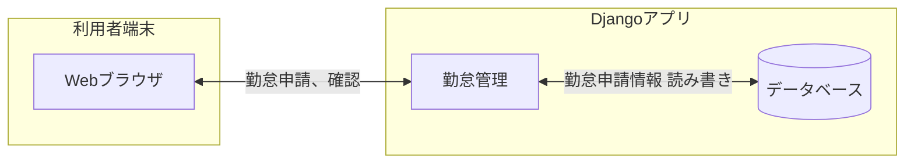
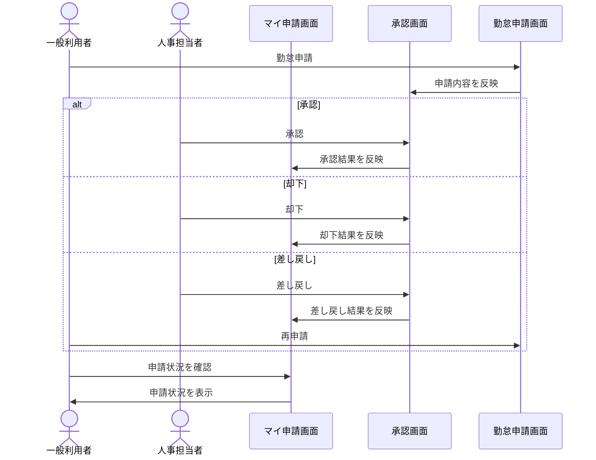
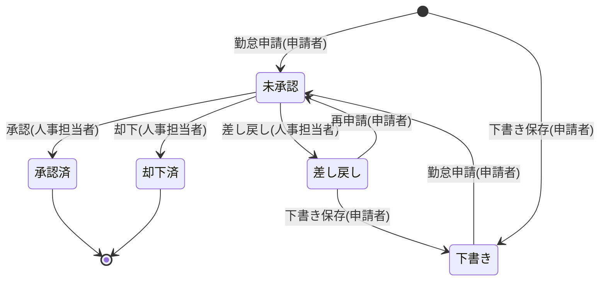
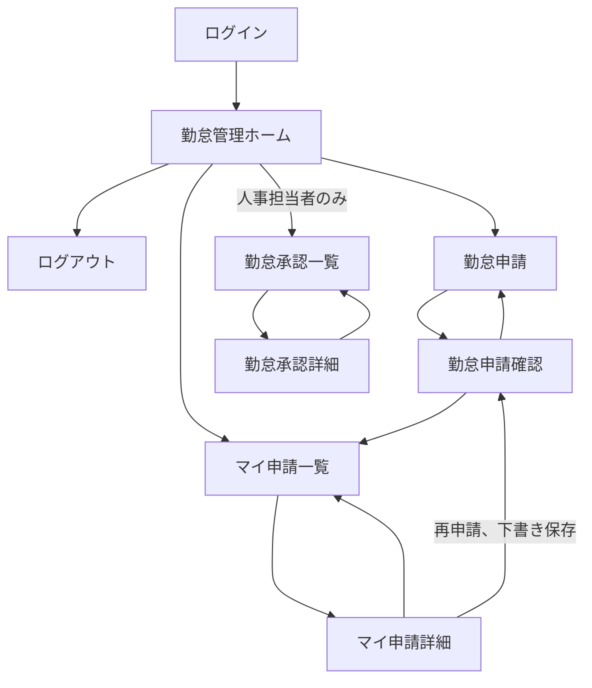
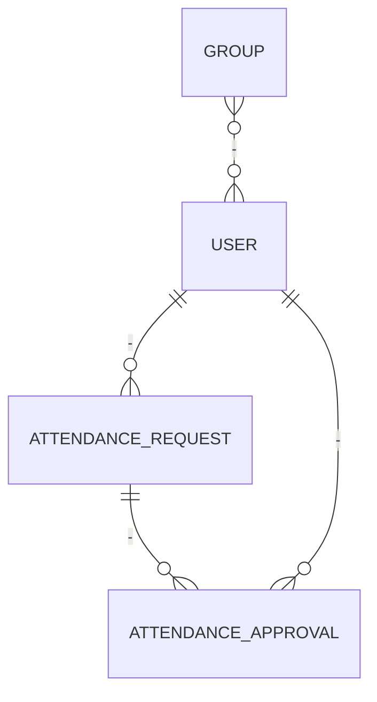

# 勤怠管理システム 基本設計書

| 項目 | 内容 |
| --- | --- |
| 文書名 | 勤怠管理システム 基本設計書 |
| 文書区分 | 基本設計書 |
| 版数 | 0.3 |
| 作成日 | 2026年10月20日 |

## 改訂履歴

| 版数 | 更新日 | 変更内容 | 作成者 |
| --- | --- | --- | --- |
| 0.1 | 2026年10月19日 | 初版作成 | 藤井 |
| 0.2 | 2026年10月19日 | 出退勤記録機能を追加要件へ移行、状態遷移図の追加など | 藤井 |
| 0.3 | 2026年10月20日 | 有給残日数表示機能を追加要件へ移行、その他修正 | 藤井 |

# 1. はじめに

## 1.1 目的

本システムは、現在紙書類により運用している有給・欠勤申請、遅刻・早退申請をWebアプリケーション上に集約し、業務の効率化、検索性の向上を実現することを目的とする。
なお、本プロジェクトは架空の企業を想定したポートフォリオであり、規模感などが現実と異なる場合がある。

主な目的は以下のとおりとする。
- 各種勤怠申請の電子化
- 勤怠申請、承認、却下および申請状況確認のワークフロー

## 1.2 対象読者

- 人事部門システム管理者
- 本システムの設計、開発、試験、保守担当者

## 1.3 用語定義

| 用語 | 定義 |
| --- | --- |
| 本システム | 本書で設計対象とする「勤怠管理システム」 |
| Django | 本システムのWebアプリケーションを構築するフレームワーク |
| 未承認 | 申請後、承認判断が行われていない状態 |
| 承認済 | 申請後、申請が承認された状態 |
| 却下済 | 申請後、申請が却下された状態 |
| 差し戻し | 申請後、申請が差し戻しされた状態 |
| 下書き | 申請前に内容を下書き保存した状態 |

## 1.4 システム範囲

### 1.4.1 対象範囲

本システムの対象範囲は、以下を基本とする。

1. 勤怠申請、下書き保存
2. 申請の承認、却下、差し戻し

### 1.4.2 対象外または別途協議

以下は現時点では対象外とする。

- 出退勤記録の電子化
- 2段階認証の導入
- Dockerによるアプリケーションのコンテナ化
- メール送信による勤怠申請結果通知機能の導入
- 有給残日数のダッシュボード表示
- 勤怠申請下書きの削除機能の導入

## 1.5 前提条件

- WebアプリケーションはDjangoで構築する。
- 勤怠データはSQLite上で管理する。

# 2. システム全体構成

## 2.1 システム構成概要

本システムは、Djangoで実装したWebアプリケーション、SQLite、PCで構成される。

## 2.2 業務フロー図

### 2.2.1 勤怠申請

## 2.3 業務ルール

### 2.3.1 勤怠申請
- 有給・欠勤：日付単位のみとし、半休は認めない。
　開始日と終了日を入力から判断(日単位)
- 早退：実際の退勤時刻と本来の終業時刻から判断(分単位)
- 遅刻：本来の始業時刻と実際の出勤時刻から判断(分単位)

## 2.4 状態遷移図

### 2.4.1 勤怠申請業務

## 2.5 技術構成

| 構成要素 | 役割 | 技術 | 備考 |
| --- | --- | --- | --- |
| 利用者端末 | 勤怠申請、承認、参照、管理操作 | WindowsPC、Webブラウザ |
| Webアプリケーション(フロントエンド) | 画面インターフェース | Django | - |
| Webアプリケーション(バックエンド) | ロジック | Python、Django | - |
| DB | マスタ、勤怠申請履歴等の保存 | SQLite | - |
| API | 勤怠申請履歴等のダウンロード | Django REST Framework、OpenAPI | 追加機能 |
| コンテナ | 全てのアプリケーションのコンテナ化 | Docker | 追加機能 |
| テスト | 自動テスト | pytest | - |

## 2.6 環境構成
原則として以下の環境を用意する。

| 環境 | 用途 | 主な利用者 |
|---|---|---|
| 開発環境 | 実装、テスト | 開発者 |

## 2.7 利用環境

- 利用場所：社内
- 利用端末：社内貸与PC
- 利用形態：Webブラウザによるオンライン利用
- 想定利用者：全社員100名
- 同時利用者数：不明
- 対応ブラウザおよびバージョン：Microsoft Edge / Google Chrome
- 利用可能時間：営業時間(9~18時を想定)

# 3. 機能設計

## 3.1 機能一覧

| 機能ID | 機能分類 | 機能名 | 概要 | 優先度 |
| --- | --- | --- | --- | --- |
| F-TNA-01 | 打刻 | 出退勤の記録 | 出退勤を記録する。 | 追加 |
| F-TNA-02 | 打刻 | 出退勤記録表示 | これまでの出退勤記録一覧で表示する | 追加 |
| F-TNA-03 | 打刻 | 出退勤記録ダウンロード | 出退勤記録をExcel形式でダウンロードする | 追加 |
| F-RES-01 | 申請 | 勤怠申請 | 勤怠に関わる申請を行う | 必須 |
| F-RES-02 | 申請 | 申請承認・却下・差し戻し | 申請内容を確認し、承認・却下・差し戻しを行う | 必須 |
| F-RES-03 | 申請 | 申請状況表示 | 自分が行った申請の状況を確認する | 必須 |
| F-DSB-01 | 分析 | 有給残日数表示 | 年次有給休暇の残日数を表示する | 追加 |

## 3.2 共通機能方針

### 3.2.1 認証・認可
- ロールにより画面表示および操作権限を制御する。
- 想定ロールは以下とする。

| ロール | 権限範囲 |
| --- | --- |
| 一般利用者 | 勤怠申請、自身の申請内容確認 |
| 人事担当者 | 一般利用者の権限に加え、勤怠申請承認(自身の申請を除く) 権限|

## 3.3 画面設計
 ### 3.3.1 画面一覧

| 画面ID | 画面名 | 主な利用者 | 主な機能 | 備考 |
| --- | --- | --- | --- | --- |
| SCR-001 | ログイン | 全利用者 | 認証 |  |
| SCR-010 | 勤怠管理ホーム | 全利用者 | 各画面へのリンクを表示 |  |
| SCR-020 | 勤怠申請 | 全利用者 | 種別、日時、コメントの登録、申請 |  |
| SCR-021 | 勤怠申請確認 | 全利用者 | 入力内容の確認、下書き保存 |  |
| SCR-022 | マイ申請一覧 | 全利用者 | 自分が行った申請の一覧 |  |
| SCR-023 | マイ申請詳細・編集 | 全利用者 | 自分が行った申請の詳細、編集 |  |
| SCR-024 | 勤怠承認一覧 | 人事担当者 | 未処理申請の一覧、絞込み |  自身の申請は表示しない |
| SCR-025 | 勤怠承認詳細 | 人事担当者 | 申請の承認、却下、差し戻し |  |

## 3.3.2 画面遷移図

# 4. データ設計

## 4.1 データ設計方針

- エンティティごとに固有のuuidを持ち、一意に区別できるようにする。
-  Django標準のモデルを用いるエンティティ(User、Group)についてはその限りでない。

## 4.2 エンティティ一覧(概要)

| エンティティ | 分類 | 概要 | 主な項目 | 備考 |
| --- | --- | --- | --- | --- |
| Group | マスタ | ロール情報 | GroupID(PK)、ロール名(UserReg、UserHR)など | 権限判断はロール名を基に行う |
| User | マスタ | ユーザ情報 | ユーザID(PK)、ユーザネーム、苗字、名前、パスワード、Groupなど |  |
| AttendanceRequest | 申請 | 勤怠申請 | 申請ID(PK)、ユーザID(FK/申請者)、申請日時、種別(有給、欠勤、遅刻、早退)、開始日時、終了日時、コメント、状態(未承認、承認済、却下済、差し戻し、下書き) |  |
| AttendanceApproval | 申請 | 承認履歴 | 承認ID(PK)、申請ID(FK)、ユーザID(FK/承認者)、処理日時、処理結果（承認・却下・差し戻し）、コメント |  |

## 4.3 ER図

# 5. 非機能要件

## 5.1 セキュリティ
- ログイン機能を導入し、利用可能なユーザを制限する。
- 他人の申請をURL直打ちで閲覧・操作できない。